  I ship ML that works on real data, not just benchmarks. Models, agents, pipelines, cloud, evals, end to end.

  
  
  

  MS Applied Machine Learning, University of Maryland · B.Tech Electrical Engineering, IIT Dharwad

## Featured projects

<table>
  <tr>
    <td width="50%" valign="top">
      
      
<b>ShuttleCast</b>: turns any badminton match video into per-rally coaching notes. Trained stroke models find the rallies; a ReAct agent decides which ones are worth analyzing. Runs as an async AWS service (Lambda → SQS → Fargate) with video upload.

      
Hit detection <b>F1 0.87</b> on raw broadcast (vs 0.37 baseline) · evals lifted correct attribution <b>62% → 94%</b> · <a href="https://www.youtube.com/watch?v=1QtO1wVZCtc">▶ demo</a>

    </td>
    <td width="50%" valign="top">
      
      
<b>FHIRFlow</b>: makes hospital lab data queryable across sources. FHIR R4 → DuckDB with data-quality rules, plus a retrieval-grounded LLM that maps local lab codes to LOINC and abstains instead of guessing.

      
<b>65%</b> exact LOINC match vs 17.5% rule baseline · MIMIC-IV lab rows LOINC-queryable from <b>0%</b>

    </td>
  </tr>
  <tr>
    <td width="50%" valign="top">
      
      
<b>FinSight</b>: a RAG system over SEC 10-K filings that answers with numbered citations, using hybrid dense + BM25 retrieval and optional cross-encoder reranking.

      
<b>9</b> chunking × retrieval strategies benchmarked; reranking <i>lowered</i> answer quality on 10-Ks · <a href="https://www.youtube.com/watch?v=IpwAQtVk1mU">▶ demo</a>

    </td>
    <td width="50%" valign="top">
      
<b>Currently building:</b> a private AI medical scribe that turns doctor–patient audio into a clinical note on a single 6 GB GPU, with no audio leaving the machine.

      
<b>Writing:</b> <a href="https://naramkeshav59.github.io">OKF vs RAG, prompt injection vs jailbreaks, CUDA for ML engineers, and more</a>

    </td>
  </tr>
</table>

## Tech stack

  

also: LangGraph · QLoRA · DINOv2 · Whisper · Wav2Vec 2.0 · DuckDB · FHIR · Airflow · MLflow · ChromaDB

## Journey

| Year | Focus | Work |
| --- | --- | --- |
| 2022 | Speech processing | Real-time voice activity detection and audio chunking ([audio_chunk_maker](https://github.com/Naramkeshav59/audio_chunk_maker)); built live transcription at an internship |
| 2023 | Speech apps | Real-time speech-to-text web app with emotion detection ([SpeechToTextApp](https://github.com/Naramkeshav59/SpeechToTextApp)) |
| 2025 | MLOps | CI/CD, Airflow orchestration, Fargate deployment ([Hotel-Booking-Demand-Predictor](https://github.com/Naramkeshav59/Hotel-Booking-Demand-Predictor)) |
| 2026 | LLM systems & healthcare data | RAG with benchmarking ([FinSight](https://github.com/Naramkeshav59/finsight)), agents and trained vision models on AWS ([ShuttleCast](https://github.com/Naramkeshav59/Shuttlecast)), clinical data interoperability ([FHIRFlow](https://github.com/Naramkeshav59/FHIRFlow)) |

